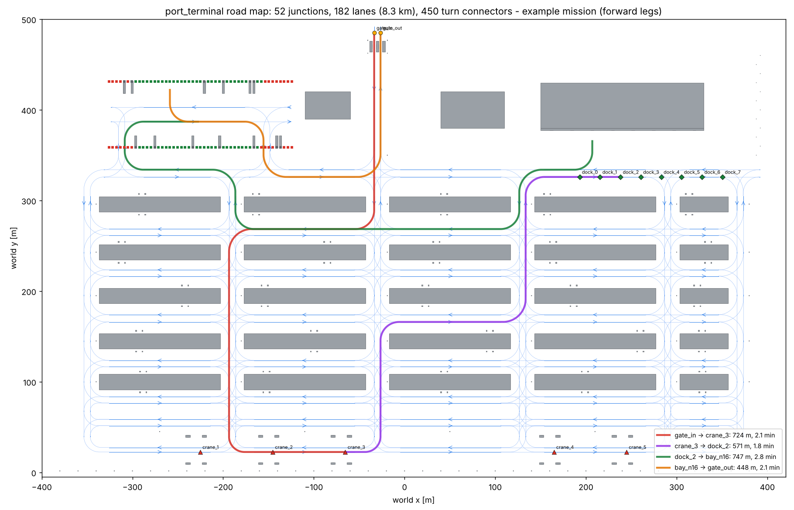
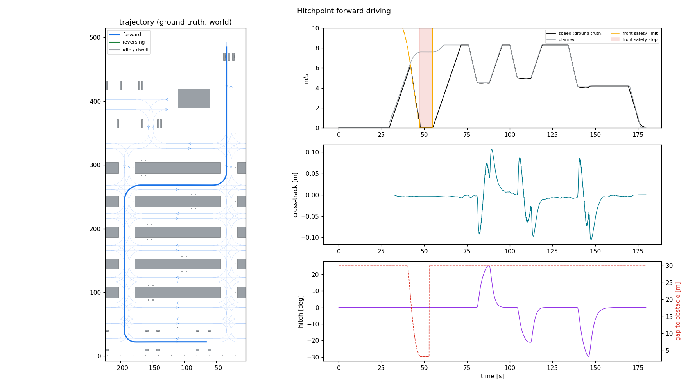
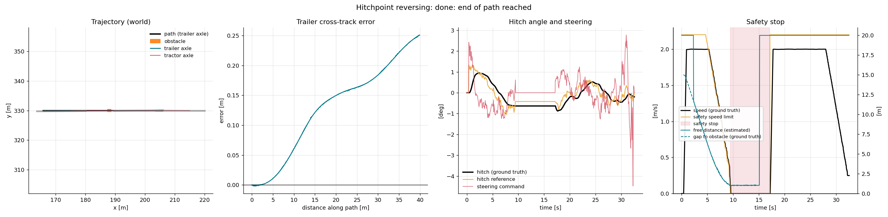

# Hitchpoint

**An autonomous articulated truck (cabless tractor + 13.6 m semi-trailer) that drives a container port on its own
lane map, stops for people and obstacles ahead and behind, and reverses the trailer into a warehouse dock door to
within a few centimetres: built in ROS 2 and Gazebo, every module measured against ground truth.**

**ROS 2 Humble · Gazebo Harmonic · ros2_control · robot_localization · Python / NumPy · SolidWorks**

*Autonomous reversing into a warehouse dock door: localization, lidar hitch-angle estimation and the reversing
controller running together in Gazebo (sped up ~30×).*

<!-- Full 15 s video: on github.com, Edit this file and drag hitchpoint_docking_15s.mp4 onto this line -->

## Headline results (Gazebo, scored on ground truth)

| | |
|---|---|
| **Forward driving** | **724 m** route at up to **30 km/h**: **3.2 cm RMSE** from the lane centre (max 10.7 cm), stopped **0.0 cm** off the line at the goal |
| **Front safety stop** | Person on the road ahead: braked from 22 km/h and stopped **3.25 m** before them (target 3.0 m); drove on by itself ~2 s after they left |
| **Rear safety stop** | Low pallet (0.5 m) behind the trailer: stopped **1.02 m** from it (target 1.0 m); no false stops at the dock |
| **Road map** | 52 junctions, 182 lanes (8.3 km); all **450 / 450** junction turns checked clear for the full truck + trailer swept path |
| **Docking** | After **193 m in reverse**, the trailer stops **3.0 cm** off the door centre line, **0.34 m** from the bumper, **0.07°** off square |
| **Reversing** | 90° reversing turns end within **2.6 cm** and **0.43°**; a 2 m start offset is closed within ~15 m |
| **Hitch-angle estimation** | **0.22° RMSE** (max 1.4°) during hard reversing, from tractor-mounted lidar, no sensor on the trailer |
| **Localization** | **0.15 m RMSE** over 883 m (wheel odometry alone: 271 m) |

## What I built

| Module | Approach |
|---|---|
| Vehicle model | URDF/xacro from my SolidWorks CAD (custom STEP → COLLADA converter that restores colours), Ackermann steering via `ros2_control`, articulated trailer, 6 lidars, 7 cameras, IMU, dual GNSS |
| Simulation world | Generated 840 × 500 m container port: ships, cranes, 25 yard blocks, road grid, warehouse with 8 dock doors; geometry merged into tiles for real-time sensor rendering |
| Localization | Dual EKF: wheel odometry + IMU in `odom`, + RTK GNSS in `map` |
| Hitch-angle estimation | 1-DOF fit of the trailer outline to lidar points + single-track kinematic model, fused in an EKF that applies late lidar scans at their own timestamp and replays newer inputs |
| Reversing control | Cascade: pure pursuit on the trailer axle → exact steady-state curvature-to-hitch-angle map → feedback-linearised hitch-angle loop, with jackknife protection |
| Docking | Plans a line-arc-line reversing path to a door's **world** position; map → world alignment from GNSS |
| Road map + routing | Lane graph generated from a road layout file; A\* with a straight-approach constraint so the trailer arrives aligned; speed profile from lane limits and lateral acceleration; swept-path check of every turn against the world; Lanelet2 export |
| Forward control | Path-curvature feed-forward with a 0.3 s preview + kinematic lateral feedback whose preview grows with speed; speed follows the planned profile, then a position loop with stop anticipation for the final metres |
| Front safety | Roof lidar, two corner lidars and a front radar → ground plane fitted per scan → obstacles inside the **swept corridor of tractor + trailer** (hitch angle integrated) 60 m ahead → braking curve with reaction time; stops on a silent sensor |
| Rear safety | Rear lidar (tilted 30° down) + radar watch the reversing corridor; obstacles are forgotten only on free-space evidence, not just because they are no longer seen |
| Mission | Sequencer: drive to a crane, dock or parking bay, reverse into docks and bays, dwell, continue; waits for GNSS alignment before planning |
| Evaluation | Every module has an evaluator against Gazebo ground truth (CSV, summary, plots) and offline unit tests |

## Driving the port

The road map is generated from a layout file of the terminal roads: one lane per direction, turn connectors at
every junction, places (STS cranes, dock doors, parking bays) attached to their lanes. Every connector is checked
against the world geometry with the swept path of the tractor **and** the 13.6 m trailer, hitch angle integrated.

| Check | Result |
|---|---|
| Junction turns, swept path clear of the world (≥ 0.5 m) | **450 / 450** (tightest 1.5 m) |
| STS cranes / dock doors serviceable, reachable from the gate and back | **5 / 5**, **8 / 8** |
| Lanelet2 export: routing-graph errors / route match on 16 test routes | **0** / within **4 cm** |
| Example mission gate → crane 3 → dock 2 → bay n16 → gate | 2.49 km, ~8.8 min of driving |

## Forward driving and front safety stop

*Gazebo, gate → crane 3. A person is placed on the road 60 m ahead of the truck and removed after the stop.*

| Gate → crane 3 (724 m, three 90° turns) | Result (ground truth) |
|---|---|
| Speed | up to **8.3 m/s (30 km/h)**, following the planned profile |
| Cross-track error | **3.2 cm RMSE**, max 10.7 cm (at turn entry / exit) |
| At the goal | **0.0 cm** lateral, 7.7 cm short, 0.01° |
| Max hitch angle | 30° |
| Person on the road | speed limit drops from ~40 m away; braked from 6.2 m/s at ~1.4 m/s²; stopped **3.25 m** before the person (target 3.0 m) |
| Restart | ~2 s after the person left (1.5 s clear + cell expiry), no operator action |

The front corridor is not a straight box: it is the area the tractor and trailer **will sweep** along the route,
so in a turn the trailer's inside corner is protected and a person standing beside a straight road is not.

## Safety stop behind the trailer

| Test (Gazebo, reversing at 2 m/s) | Result |
|---|---|
| Low pallet (1.2 × 0.8 × 0.5 m) on the path | stopped **1.02 m** from it (estimated 0.98 m); released by itself 2.7 s after removal |
| Person on the path | detected 14.9 m away, stopped **1.03 m** from them |
| Person 2.3 m beside the path | no stop, no slow-down |
| Dock door 1, no obstacle (bumper and platform behind the goal) | **no false stop**; docked 3.4 cm off the centre line |

## Docking

| At the dock (trailer rear, ground truth) | Door 0 (193 m approach) | Door 1 (58 m approach) |
|---|---|---|
| lateral offset from the door centre line | **+3.0 cm** | −1.7 cm |
| gap to the bumper (target 0.30 m) | **0.336 m** | 0.335 m |
| angle | **−0.07°** | −0.01° |

On the 137 m straight part of the approach the trailer stayed within ±3.5 cm of the path.

## Reversing

A trailer reversing on its own is unstable: the hitch angle grows until it jackknifes. The controller steers the
tractor to hold a target hitch angle, and chooses that angle so the trailer follows the path.

| Run | Cross-track RMSE | Final lateral | Final heading | Max hitch |
|---|---|---|---|---|
| straight, starting 2 m off the line | 0.12 m once converged | +12.9 cm | −0.18° | 25° |
| 90° left, R = 20 m | 0.153 m | −1.5 cm | −0.22° | 25° |
| 90° right, R = 20 m | 0.160 m | −2.6 cm | +0.43° | 25° |

## Hitch-angle estimation

Real trailers carry no angle sensor (they are swapped between tractors), so the angle is estimated from the tractor.

| Source | RMSE | Max | Availability |
|---|---|---|---|
| lidar fit | 0.245° | 0.85° | 99.8 % |
| kinematic model alone | 14.9° | 81.7° | 100 % |
| **fused EKF** | **0.223°** | **1.45°** | 100 % |

The model on its own runs away in reverse; the lidar keeps the fused estimate on track, and the fusion beats the
lidar alone.

## Localization

| Source | RMSE | Final error | Drift |
|---|---|---|---|
| wheel odometry | 271 m | 434 m | 49.2 % |
| EKF wheel + IMU | 11.2 m | 18.3 m | 2.08 % |
| **EKF + RTK GNSS** | **0.152 m** | **0.198 m** | 0.02 % |

## Problems found and solved

- **16 cm lateral drift that grew with distance.** Arrival error was 0.16 m at 460 m from the start, too regular to be
  noise. Cause: robot_localization's `map` frame is in UTM scale (k = 0.99966 here), so map metres are not world
  metres. Converting with the UTM scale factor → **0.0 cm** lateral at the goal, tracking RMSE 11.5 → 3.2 cm.
- **A blind zone behind the trailer.** Ray-casting the sensors against the trailer mesh showed a level rear lidar
  cannot see a pallet close behind the bumper, and neither can the radar: a "forget what you no longer see" rule
  would reverse into it. Fixed twice: obstacles are forgotten only on free-space evidence, and the lidar is now
  tilted 30° down (angle chosen from the same ray-cast).
- **Stopping 1.9 m instead of 3 m before an obstacle** at full speed in the offline tests: the braking curve had no
  reaction time. Added the reaction-time term → 2.9 m offline, 3.25 m in Gazebo.

- **Hitch estimate spikes (3.6°) during hard reversing.** Traced from the logged errors to wheel spin: odometry
  speed read high and was re-applied after every late lidar scan. Reproduced offline, fixed by taking speed from the
  GNSS-corrected EKF → max 1.4°.
- **GNSS noise in degrees.** Gazebo applies NavSat horizontal noise in degrees, not metres as the SDF spec says, so
  "2 cm" was ~2 km. Confirmed for Harmonic on [gazebosim/sdformat#1572](https://github.com/gazebosim/sdformat/issues/1572).
- **EKF trusting every GNSS fix completely.** The ROS–Gazebo bridge publishes fixes with zero covariance; added
  a node that sets the real covariance.
- **robot_localization `use_local_cartesian`** (Humble 3.5.4) mixes local and UTM coordinates (fixes landed
  ~5,800 km away); found in the source, documented, avoided.
- **Wheel-odometry heading fails with a trailer** (drive-axle slip in turns): the hitch model uses the IMU.
- **An integral term** for the 0.2 m arc offset was tried and dropped: it made the final docking accuracy worse.

## Roadmap

- [x] Vehicle model, port world, sensors
- [x] Localization, hitch-angle estimation
- [x] Reversing control and docking, rear safety stop
- [x] Road map, routing, Lanelet2 export
- [x] Forward driving, front safety stop
- [ ] Full mission in Gazebo (crane → dock → parking bay → gate)
- [ ] Lidar-map localization through GNSS outages
- [ ] Randomized scenario runs, fault injection, CI

## Source code

The source code is in a private repository. **Recruiters and hiring teams: read access on request**:
Waseem Sajjad 

---
© 2026 Waseem Sajjad. All rights reserved. No license is granted to use, copy, modify or distribute this work.
