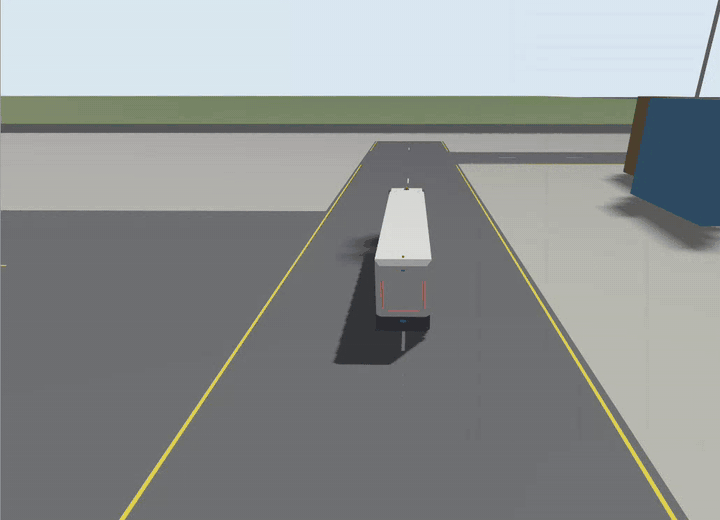
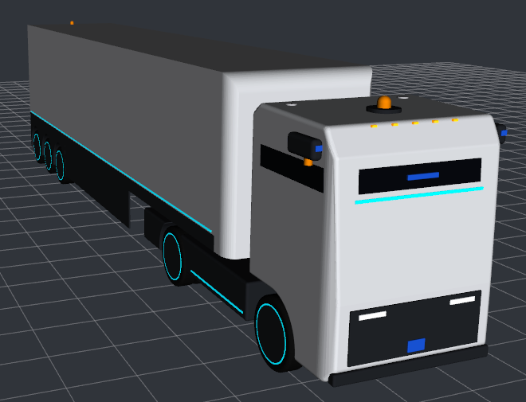
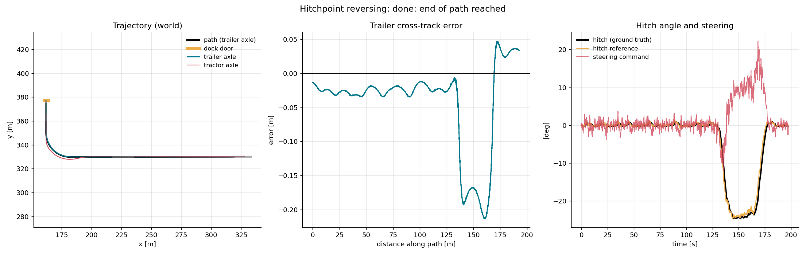
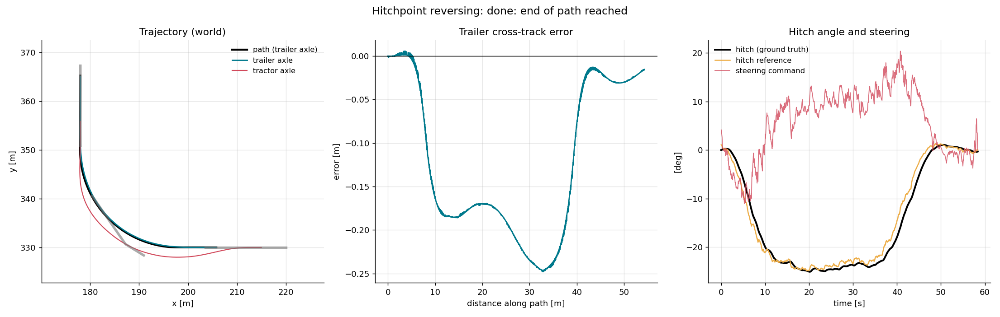
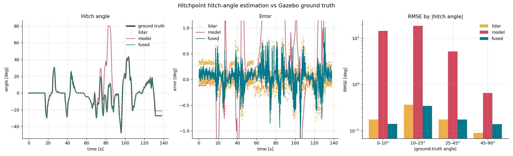
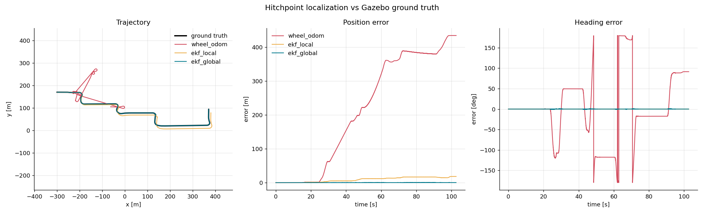

# Hitchpoint

**An autonomous articulated truck (cabless tractor + 13.6 m semi-trailer) that localizes itself, estimates its
trailer angle from lidar, and reverses the trailer into a warehouse dock door to within a few centimetres:
built in ROS 2 and Gazebo, every module measured against ground truth.**

**ROS 2 Humble · Gazebo Harmonic · ros2_control · robot_localization · Python / NumPy · SolidWorks**

*Autonomous reversing into a warehouse dock door: localization, lidar hitch-angle estimation and the reversing
controller running together in Gazebo (sped up ~30×).*

 ▶ **[Watch the 15 s video](docs/hitchpoint_docking_15s.mp4)** (Gazebo + RViz + evaluator result)

## Headline results (Gazebo, scored on ground truth)

| | |
|---|---|
| **Docking** | After **193 m in reverse**, the trailer stops **3.0 cm** off the door centre line, **0.34 m** from the bumper, **0.07°** off square |
| **Reversing** | 90° reversing turns end within **2.6 cm** and **0.43°**; a 2 m start offset is closed within ~15 m |
| **Hitch-angle estimation** | **0.22° RMSE** (max 1.4°) during hard reversing, from tractor-mounted lidar, no sensor on the trailer |
| **Localization** | **0.15 m RMSE** over 883 m (wheel odometry alone: 271 m) |

## What I built

| Module | Approach |
|---|---|
| Vehicle model | URDF/xacro from my SolidWorks CAD (custom STEP → COLLADA converter that restores colours), Ackermann steering via `ros2_control`, articulated trailer, 6 lidars, 7 cameras, IMU, dual GNSS |
| Simulation world | Generated 840 × 500 m container port: ships, cranes, 25 yard blocks, road grid, warehouse with 8 dock doors; geometry merged into tiles for real-time sensor rendering |
| Localization | Dual EKF: wheel odometry + IMU in `odom`, + RTK GNSS in `map` |
| Hitch-angle estimation | 1-DOF fit of the trailer outline to lidar points + single-track kinematic model, fused in an EKF that applies late lidar scans at their own timestamp and replays newer inputs |
| Reversing control | Cascade: pure pursuit on the trailer axle → exact steady-state curvature-to-hitch-angle map → feedback-linearised hitch-angle loop, with jackknife protection |
| Docking | Plans a line-arc-line reversing path to a door's **world** position; map → world alignment from GNSS |
| Evaluation | Every module has an evaluator against Gazebo ground truth (CSV, summary, plots) and offline unit tests |

## Docking

| At the dock (trailer rear, ground truth) | Door 0 (193 m approach) | Door 1 (58 m approach) |
|---|---|---|
| lateral offset from the door centre line | **+3.0 cm** | −1.7 cm |
| gap to the bumper (target 0.30 m) | **0.336 m** | 0.335 m |
| angle | **−0.07°** | −0.01° |

On the 137 m straight part of the approach the trailer stayed within ±3.5 cm of the path.

## Reversing

A trailer reversing on its own is unstable: the hitch angle grows until it jackknifes. The controller steers the
tractor to hold a target hitch angle, and chooses that angle so the trailer follows the path.

| Run | Cross-track RMSE | Final lateral | Final heading | Max hitch |
|---|---|---|---|---|
| straight, starting 2 m off the line | 0.12 m once converged | +12.9 cm | −0.18° | 25° |
| 90° left, R = 20 m | 0.153 m | −1.5 cm | −0.22° | 25° |
| 90° right, R = 20 m | 0.160 m | −2.6 cm | +0.43° | 25° |

## Hitch-angle estimation

Real trailers carry no angle sensor (they are swapped between tractors), so the angle is estimated from the tractor.

| Source | RMSE | Max | Availability |
|---|---|---|---|
| lidar fit | 0.245° | 0.85° | 99.8 % |
| kinematic model alone | 14.9° | 81.7° | 100 % |
| **fused EKF** | **0.223°** | **1.45°** | 100 % |

The model on its own runs away in reverse; the lidar keeps the fused estimate on track, and the fusion beats the
lidar alone.

## Localization

| Source | RMSE | Final error | Drift |
|---|---|---|---|
| wheel odometry | 271 m | 434 m | 49.2 % |
| EKF wheel + IMU | 11.2 m | 18.3 m | 2.08 % |
| **EKF + RTK GNSS** | **0.152 m** | **0.198 m** | 0.02 % |

## Problems found and solved

- **Hitch estimate spikes (3.6°) during hard reversing.** Traced from the logged errors to wheel spin: odometry
  speed read high and was re-applied after every late lidar scan. Reproduced offline, fixed by taking speed from the
  GNSS-corrected EKF → max 1.4°.
- **GNSS noise in degrees.** Gazebo applies NavSat horizontal noise in degrees, not metres as the SDF spec says, so
  "2 cm" was ~2 km. Confirmed for Harmonic on [gazebosim/sdformat#1572](https://github.com/gazebosim/sdformat/issues/1572).
- **EKF trusting every GNSS fix completely.** The ROS–Gazebo bridge publishes fixes with zero covariance; added
  a node that sets the real covariance.
- **robot_localization `use_local_cartesian`** (Humble 3.5.4) mixes local and UTM coordinates (fixes landed
  ~5,800 km away); found in the source, documented, avoided.
- **Wheel-odometry heading fails with a trailer** (drive-axle slip in turns): the hitch model uses the IMU.
- **An integral term** for the 0.2 m arc offset was tried and dropped: it made the final docking accuracy worse.

## Source code

The source code is in a private repository. **Recruiters and hiring teams: read access on request**:
Waseem Sajjad · roboticengineer4590@gmail.com

---
© 2026 Waseem Sajjad. All rights reserved. No license is granted to use, copy, modify or distribute this work.
