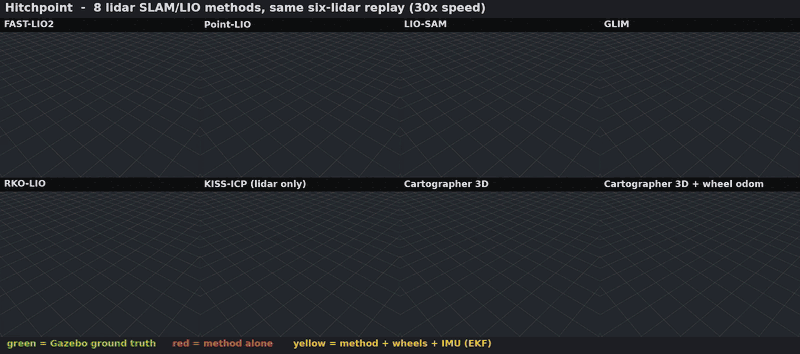

# Lidar SLAM / LIO benchmark

Eight open-source lidar odometry and SLAM methods, run one after the other on the **same recorded drive** of the
Hitchpoint articulated truck through a container yard (Gazebo, ROS 2 Humble, about 11 minutes). Every method gets
the same input and is scored against the Gazebo ground truth by the same evaluation node.

Green: Gazebo ground truth. Red: the method alone. Yellow: the method fused with wheel odometry and IMU in an EKF.
Sharper video (15x speed): [hitchpoint_all_methods_15x.mp4](../media/hitchpoint_all_methods_15x.mp4)

## Setup

- **Sensors:** six lidars on the truck (roof, two side, two low corner, one on the trailer rear) merged into one
  cloud in the roof lidar frame, an IMU, wheel odometry from the Ackermann controller, and RTK GNSS.
- **Self-filtering:** the tractor and trailer outline is cut out of every cloud; the trailer box is rotated with the
  live hitch (fifth-wheel) angle, so the truck never sees itself.
- **Replay:** one rosbag played into each method with simulation time taken from the sensor stamps, so every method
  sees the identical drive.
- **Scoring:** each estimate is aligned to the truth over its first seconds only, then left alone, so drift shows.
  ATE, maximum error, final error and relative error per distance are logged per method.
- **Fusion:** each method is also fed into a `robot_localization` EKF together with wheel odometry and IMU, and a
  second EKF adds GNSS (with a 60 s outage) and lidar map localization.

## Results

RMSE and maximum position error against the Gazebo ground truth over the whole run, in metres. Each estimate is aligned
to the truth over its first seconds only. The map column adds lidar map localization and GNSS with a 60 s GNSS outage;
its maximum is reached during that outage.

| Method | Alone: RMSE / max | + wheels + IMU (EKF): RMSE / max | + map localization: RMSE / max |
|---|---|---|---|
| LIO-SAM | **0.25** / 0.39 | 0.44 / 0.68 | 0.036 / 0.13 |
| Point-LIO | 0.39 / 0.63 | 0.42 / 0.65 | 0.034 / 0.13 |
| Cartographer 3D | 0.45 / 0.82 | 0.61 / 1.11 | 0.038 / 0.14 |
| GLIM | 0.49 / 0.71 | 0.38 / 0.59 | 0.036 / 0.13 |
| FAST-LIO2 | 0.51 / 0.69 | 0.38 / 0.62 | 0.036 / 0.13 |
| Cartographer 3D + wheel odometry | 0.79 / 1.35 | **0.34** / 0.53 | 0.034 / 0.13 |
| RKO-LIO | 1.50 / 2.97 | 0.37 / 0.54 | diverged in this run (see below) |
| KISS-ICP (lidar only) | 14.85 / 21.96 | 0.54 / 0.77 | 0.036 / 0.13 |

Reading the table:
- **The best lidar methods do not need the wheels.** LIO-SAM and Point-LIO alone are as good as or better than the
  same method inside the EKF; the filter's wheel odometry slips a little on an articulated truck.
- **The EKF is a safety net, not an accuracy boost.** It brings every method, including the two that drift badly on
  their own, within 0.8 m maximum error.
- **Map localization dominates.** With the prior lidar map, seven of eight runs stay at 3 to 4 cm RMSE and 0.13 m
  maximum, also through the 60 s GNSS outage. In the RKO-LIO run the map localization diverged (428 m); the same
  localizer works in all other runs, so this is a failure of the map matching in that run, still being investigated.

## What went wrong, and what fixed it

**Methods "sticking" to the ground.** Gazebo's ground is perfectly flat and noise free, so a spinning lidar sees
exactly the same rings on it in every scan, wherever the truck is. Point-to-point ICP (KISS-ICP, RKO-LIO) and
Cartographer's scan matcher matched those rings to themselves and under-estimated the motion: KISS-ICP stood almost
still while the truck drove on (230 m error), Cartographer lost about 6 m the moment the truck started. Point-to-plane
methods (FAST-LIO2, Point-LIO) get no pull along the road from a plane and were not affected.
Fix: a second cloud without the ground (estimated per scan) for those three methods. Cartographer went from 6.9 m to
0.8 m maximum error, KISS-ICP from 230 m to 22 m. I reproduced the effect offline with KISS-ICP on a synthetic yard before changing
the pipeline (113 m with the ground, 0.5 m without).

**Point-LIO falling behind.** Point-LIO runs one filter update per lidar point; on the six-lidar cloud it published
at 0.14 Hz and fell 18 s behind real time, so its estimate never moved. Keeping every 12th point and replaying at
half speed brought it to 0.6 m.

**Fusion as a safety net.** Every method, including the two that drift, stays within 0.8 m once it is fused with
wheel odometry and IMU, and within 0.14 m with the lidar map. For the strongest methods the EKF does not improve
accuracy; its value is that no single sensor failure can run away with the pose.

## Tools built for this

- `cloud_merge`: six lidars to one cloud, truck and trailer removed with the live hitch angle
- `live_viz`: RViz view of the truth, the method and the fused estimate, with live error text
- automatic recording: two virtual screens, two RViz views (top and isometric) and ffmpeg per method, unattended
- offline replay of the lidar input through KISS-ICP for tuning without ROS
