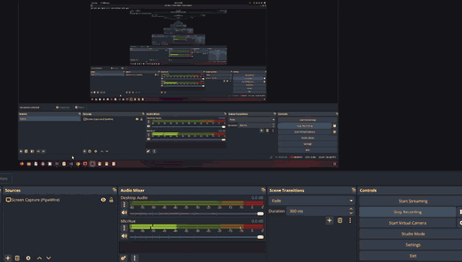

# Lidar perception: detection, tracking and prediction

Detection, tracking and 0–4 s prediction of the moving traffic around the truck: terminal trucks, external trucks,
reach stackers, forklifts and people on foot in the container yard. It is written in C++ (ROS 2 Humble), runs on a
laptop CPU with no GPU, and is scored every scan against the simulator's recorded ground truth.

## Results

The test drive is a full-rate recording of the gate → crane 3 mission through the changed yard with 13 scripted
vehicles. It has six lidars at 10 Hz and the ground truth recorded in the same bag, and it was replayed into the
tracker.

| | recall | precision | MOTA | ID switches | prediction error 1 / 2 / 3 s |
|---|---|---|---|---|---|
| First version (old recording) | 0.66 | 0.46 | −0.18 | 35 | 1.80 / 5.55 / 6.83 m |
| **Current** | **0.82** | **0.85** | **0.67** | **6** | **1.60 / 2.47 / 3.61 m** |

Recall per kind: external trucks 0.95, forklifts 0.96, terminal trucks 0.84, workers 0.64. Processing takes about
22 ms per scan on the CPU. The prediction error is from the offline replay of the same drive. Prediction errors are
scored only for tracks that match a real object.

## Pipeline

1. **Six lidars, one cloud:** one long-range roof lidar plus near-field blind-spot lidars and a lidar on the
   trailer. The tractor and trailer are cut out of every scan with the live hitch angle.
2. **Detection:** ground removal and a 0.3–9 m height band (a reach stacker holds its container up to 8.7 m).
   Euclidean clustering runs on the ground plane with a distance that grows with range, so far objects are sparse
   but stay whole. Each cluster gets an oriented box. A truck that merges with a container row it passes is split
   out again instead of being dropped.
3. **Road area from the lane map:** detections off the Lanelet2 lanes are dropped, as Autoware's lanelet filter does.
4. **Is it moving?** A point is moving if, seen from where the lidar was a fraction of a second ago, it stands in
   front of what the lidar saw through then. Static structure never does. This is the principle of M-detector
   (Nature Communications 2024), implemented here per scan with depth images.
5. **Tracking:** an EKF per object with a constant turn rate and velocity model, and Hungarian association in two
   stages: confirmed tracks first, and weak detections never start a track. Detections that fall inside a confirmed
   track's box are merged into one, as Autoware's detection-by-tracker does. Tracks also keep a size memory and
   coast for 2.5 s behind container stacks.
6. **Prediction, 0–4 s:** constant velocity, the turn-rate arc, and lane following on the Lanelet2 map. An adaptive
   choice per track uses whichever model has predicted that track best lately, so it needs no ground truth and
   runs live.

## How it got there

Each change was measured on the same recorded drive, one at a time, and the literature pointed to which changes to
make. The order below follows the work.

| Change | Problem it fixed | Effect |
|---|---|---|
| Moving test based on occlusion (replaces a free-space grid) | Rays grazing container faces looked like motion | Main precision gain |
| Merging detections inside a track's box | A truck seen as cab + trailer, or cut in pieces | Removing it drops precision 0.68 → 0.41 (synthetic drives) |
| Two-stage association and a box gate | Container fragments taking over a truck's track | ID switches 35 → 4 |
| Less position noise for long boxes, more acceleration noise | 10 m/s trucks tracked at 5–9 m/s, 3–4 m behind | External truck recall 0.31 → 0.71 |
| No occlusion test within 6 m of the lidar | Thin tall structure at the gate looked like motion | Precision 0.69 → 0.80 |

## Problems found on the way

- **Point clouds lost between processes.** Six lidar clouds of about 0.7 MB each at 10 Hz overflowed Fast DDS's
  default shared memory. Larger messages go over UDP in fragments, and one lost fragment drops the whole cloud.
  Measured: 18 of 100 merged clouds arrived. With larger shared-memory segments, 99 of 100 arrived, and the new
  recording holds every lidar at exactly 10 Hz.
- **Python was the bottleneck.** The Python lidar merge managed about 1.5 clouds per second; rewritten in C++, it
  keeps up at full rate.
- **Ground truth has to be recorded, not recomputed.** On the first recording the truth was recomputed afterwards,
  and for an oncoming convoy it put trucks where the lidar saw nothing. Truck recall read 0.45. With the truth
  recorded in the bag, it reads 0.84.
- **A scoring bug that looked like bad prediction.** A finished scripted vehicle is parked 566 m away in one step.
  Ten predictions scored against that jump turned a median 1 s error of 1.1 m into a mean of 6.8 m. Jumps faster
  than 40 m/s are now excluded from scoring.

## Open

- The reach stacker is tracked at the right place and speed but never marked as moving.
- Workers: 0.64 recall.
- A learned detector (PointPillars, trained in the cloud on auto-labelled drives, TensorRT on the laptop GPU),
  compared with this pipeline on the same recorded ground truth.
